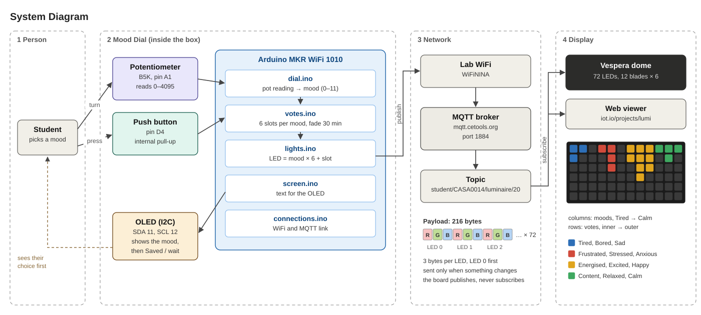
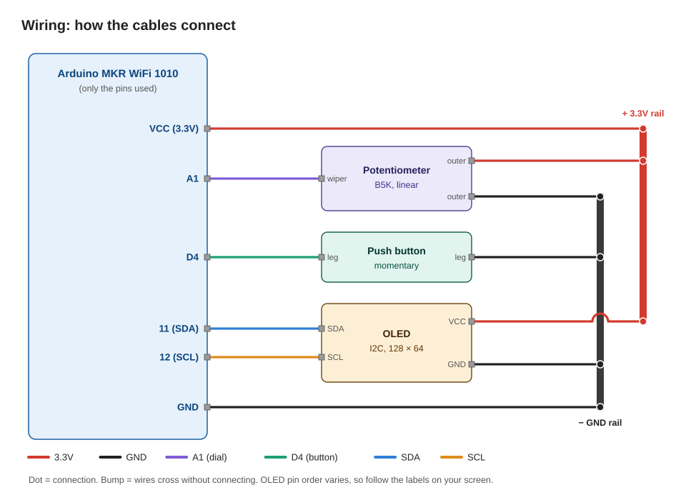
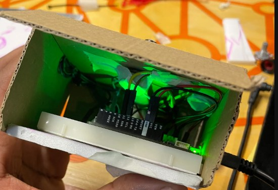
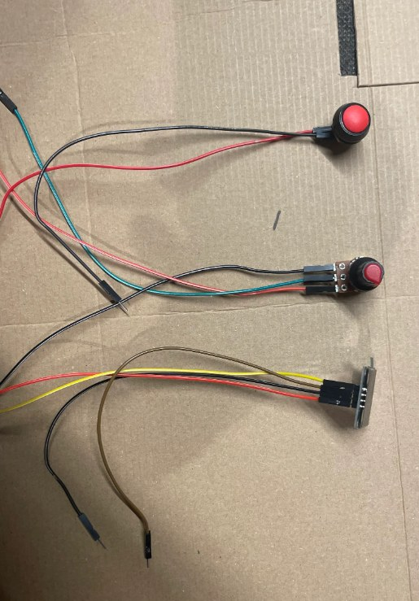
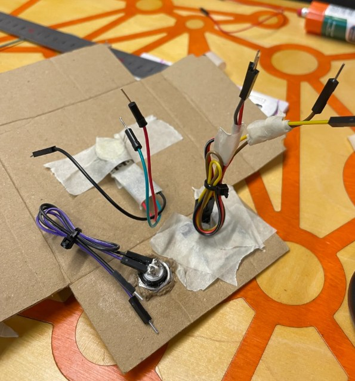
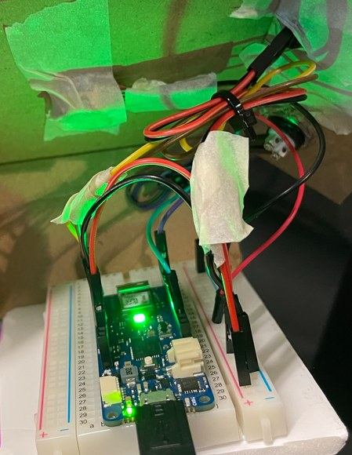

# Vespera as a Mood Meter

Mood shapes how we think and behave [1], which matters in a classroom, yet it's one of
the least visible things in it. This project turns Vespera [2] into a physical mood
meter inspired by the Yale Mood Meter [3], allowing students to check in with their
current emotional state.

|                    Pick a mood                     |                     Check in                      |             Watch the dome (Vespera)             |
| :------------------------------------------------: | :-----------------------------------------------: | :----------------------------------------------: |
|  |  |  |
|          Turn the dial to one of 12 moods          |        Press the button; the OLED confirms        |         Your vote lights up on the dome          |

## Contents

- [Concept](#concept)
- [Design](#design)
- [Bringing it together](#bringing-it-together)
- [The code](#the-code)
- [Test scripts](#test-scripts)
- [Demo](#demo)
- [Room for Progress](#room-for-progress)
- [References](#references)
- [Acknowledgements](#acknowledgements)

## Concept

The Yale Mood Meter [3] splits emotion into four colour zones, following Russell's
circumplex model of affect [4]: emotion as a circle set by two axes (energy and
pleasantness).

From my understanding, Russell's model provides the theory, and the Yale Mood Meter
is its practical implementation, a colourful, user-friendly tool. **So in this project, I try to build a third bridge, bringing that framework into our physical classroom through Vespera as a check-in (IoT) system.**

|                                                                          Theory                                                                           |                               Mapping                               |
| :-------------------------------------------------------------------------------------------------------------------------------------------------------: | :-----------------------------------------------------------------: |
|                                                |                   |
| Russell's circumplex: emotions on a 2D plane _[Wikimedia Commons](https://commons.wikimedia.org/wiki/File:Circumplex_model_of_emotion.svg), [CC BY-SA 4.0](https://creativecommons.org/licenses/by-sa/4.0/)_ | 12 moods across 4 colour zones, on a 1D dial _Printed dial face_ |

The 12 moods sit around the dial in circumplex order, three per zone.

## Design

The dial (a potentiometer) stands in for the circumplex. Turning it moves through the
12 moods, and the OLED shows which one you're on.

Each blade holds up to 6 votes (one per LED), and each vote fades after 30 minutes, so
the dome shows how the room feels now, not a running total. There's a 30-second wait
between check-ins.

McEwen and Cassimally describe an IoT system as:

> Physical object + sensors, actuators or controllers + network connectivity =
> "Internet of Things" [7, p. 11]

What you might find interesting is where the sensing happens here. Usually the sensor measures
the environment, but no sensor can measure mood directly. **So the student senses their
own mood**, and the dial and button just record it. In this system, the person is part
of the sensor.

|  #  | Block     | What it does                                                                                                                       |
| :-: | --------- | ---------------------------------------------------------------------------------------------------------------------------------- |
|  1  | Person (Sensor)    | Turns the dial to their mood and presses the button. The OLED shows the choice before it's sent (the dashed line).                 |
|  2  | Mood Dial | Turns the reading into a mood, keeps each vote for 30 minutes and builds the 72-LED picture.                                       |
|  3  | Network   | Sends the picture over WiFi to the MQTT broker, on topic `student/CASA0014/luminaire/STUDENT_NUMBER`, only when something changes. |
|  4  | Display   | Vespera and the web viewer both show my topic: one blade per mood, one LED per vote.                                               |

## Bringing it together

Alright, so we've got the theory in place. Now let's put the pieces together and see
how the system works in practice.

### What you need

| Part                                                                 | Qty |
| -------------------------------------------------------------------- | :-: |
| Arduino MKR WiFi 1010                                                |  1  |
| Linear potentiometer (B5K; anything from 1k to 50k works) and a knob |  1  |
| Momentary push button, panel mount (12 mm)                           |  1  |
| 0.96" I2C OLED (SSD1306)                                             |  1  |
| Half-size breadboard                                                 |  1  |
| Jumper wires                                                         | ~12 |
| Micro-USB cable, cardboard, cable ties, glue and tape                |  –  |

### Wiring

Everything runs on 3.3V, since the MKR1010's pins aren't 5V tolerant. The button needs
no resistor, because the code uses the board's internal pull-up.

### The box

A fold-up cardboard box (9.5 × 9.5 × 4.5 cm) with an open bottom, so it lifts off to
reach the wiring. The templates are in [`docs/enclosure`](docs/enclosure): [`box_net.pdf`](docs/enclosure/box_net.pdf) and
[`mood_wheel.pdf`](docs/enclosure/mood_wheel.pdf) (print both at 100%).

|                      Outside                      |                     Inside                      |
| :-----------------------------------------------: | :---------------------------------------------: |
|  |  |

### Putting it together

1. Print, cut and fold the box, and cut the holes.
2. Fit the pot through the lid and the button and OLED on the front, then stick the
   board and breadboard to the base.
3. Wire it up as above, leaving some slack so the box can lift off.
4. Upload `mood_dial` (see [Setting it up](#setting-it-up)). Fully anticlockwise should
   show **Tired**, fully clockwise **Calm**. If not, swap the pot's outer legs.
5. Glue the wheel on and fit the knob, lined up with the mood on the OLED.

|                      Parts wired                      |                Wires through the lid                |            Board on the breadboard             |
| :---------------------------------------------------: | :-------------------------------------------------: | :--------------------------------------------: |
|  |  |  |

## The code

The main sketch is in `src/mood_dial`, split into tabs:

| File                            | Purpose                                                            |
| ------------------------------- | ------------------------------------------------------------------ |
| `mood_dial.ino`                 | settings, `setup()` and `loop()`                                   |
| `dial.ino`                      | reads the pot and picks a mood                                     |
| `votes.ino`                     | stores votes and clears them after 30 minutes                      |
| `lights.ino`                    | builds the LED picture (LED = mood × 6 + slot) and publishes it    |
| `screen.ino`                    | the OLED                                                           |
| `connections.ino`, `RGBLED.ino` | WiFi, MQTT and the status LED (adapted from the workshop code [2]) |

### Setting it up

1. Install WiFiNINA, PubSubClient, Adafruit SSD1306 and Adafruit GFX from the Library
   Manager.
2. Copy `arduino_secrets.example.h` to `arduino_secrets.h` and add your WiFi and MQTT
   details (it's git-ignored).
3. Set `lightId` in `mood_dial.ino` to your allocated **Student number** (Ask your instructor).
4. Upload. Once it connects, a white LED sweeps around the dome and then clears.

## Test scripts

Built up one step at a time, so each part was proven before the next was added
(see [`tests`](tests)):

|  #  | Script                                                 | Proves                                  |
| :-: | ------------------------------------------------------ | --------------------------------------- |
|  1  | [`dial_v1_raw`](tests/dial/dial_v1_raw)               | the pot reads 0–4095                    |
|  2  | [`dial_v2_mood`](tests/dial/dial_v2_mood)             | the reading maps to 12 moods            |
|  3  | [`dial_v3_oled`](tests/dial/dial_v3_oled)             | the mood shows on the OLED              |
|  4  | [`dial_v4_hysteresis`](tests/dial/dial_v4_hysteresis) | boundaries don't flicker                |
|  5  | [`button_v1_read`](tests/button/button_v1_read)       | the button reads pressed / not pressed  |
|  6  | [`button_v2_count`](tests/button/button_v2_count)     | presses are counted cleanly (debounced) |
|  7  | [`mqtt_washes`](tests/vespera/mqtt_washes)            | the full network path to Vespera works  |
|  8  | [`blade_finder`](tests/vespera/blade_finder)          | which LED number sits on which blade    |

Results:

- **Pot range:** about 8 to 4000, so every mood is reachable.
- **Flicker:** with the knob held on a boundary, the mood kept flipping between the
  two neighbours; with a 40-count dead band it stayed put.
- **Debounce:** without it, one press sometimes counted twice; at 25 ms it was clean.

## Demo

<!-- Demo video: in the GitHub editor, drag the .mp4 onto this line -->

Side by side with the Mood Meter [5], the dome becomes a live mood chart. In the web
viewer [6], each column is a mood (Tired → Calm) and each row is a vote (1st → 6th),
coloured by zone.

|                     Mood Meter                      |                 Vespera grid                  |
| :-------------------------------------------------: | :-------------------------------------------: |
|  |  |
 
## Room for Progress

### Known limitations
 
- **It needs WiFi.** If the connection drops, the board reconnects, but the dome only
  updates again at the next check-in or fade.
- **Votes live in memory**, so unplugging the board clears them.
- **The 30-second wait is shared**, not per person, so in a busy room people have to
  take turns.
- **A blade holds 6 votes.** Extra check-ins for a full mood are ignored until older
  ones fade.
- **The broker is shared.** Anyone with the class login can read or publish to my
  topic.

### Next steps
- Re-send the dome after reconnecting, and save votes to flash so a restart doesn't
  wipe them.
- Swap the pot for a rotary encoder, so the dial loops round like the circumplex
  instead of stopping at Tired and Calm.
- Log a room reading (temperature or light) with each check-in, to compare mood with
  the room.
- High-fidelity mood tracking with a sturdier enclosure (laser-cut or 3D-printed) and soldered wiring.

## References

1. Naranowicz, M. (2022). Mood effects on semantic processes: Behavioural and
   electrophysiological evidence. _Frontiers in Psychology_, 13, 1014706.
   https://doi.org/10.3389/fpsyg.2022.1014706
2. Wilson, D. _Vespera_. CASA0014, UCL CASA.
   https://github.com/ucl-casa-ce/casa0014/tree/main/vespera
3. Yale Center for Emotional Intelligence. _Mood Meter_. RULER Approach.
   https://rulerapproach.org/wp-content/uploads/2020/07/MoodMeter_FC.pdf
4. Russell, J. A. (1980). A circumplex model of affect. _Journal of Personality and
   Social Psychology_, 39(6), 1161–1178.
   https://pdodds.w3.uvm.edu/research/papers/others/1980/russell1980a.pdf
5. University of New Hampshire. _Mood Meter_ (2020).
   https://unhconnect.unh.edu/s/1518/images/gid4/editor_documents/moodmeter-2020.pdf
6. IoT.io. _Lumi_ (Vespera web viewer). https://www.iot.io/projects/lumi/
7. McEwen, A., & Cassimally, H. (2014). _Designing the Internet of Things_. Wiley.

## Acknowledgements

- **Base code:** WiFi/MQTT connection handling adapted from the CASA0014 workshop
  sketch by Duncan Wilson [2].
- **AI assistance:** Claude (Anthropic) helped draft test sketches, explain the
  workshop code, generate diagrams, and review this README. All outputs were tested
  and edited by me.
