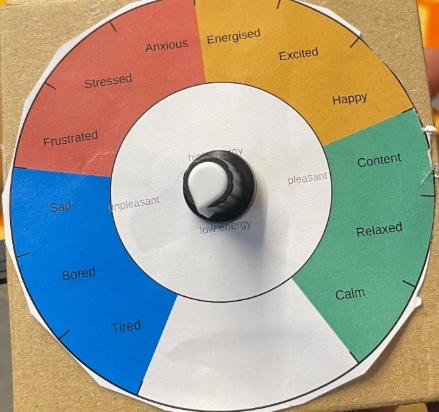
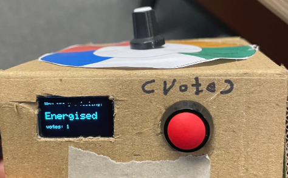
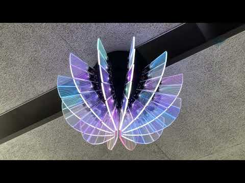
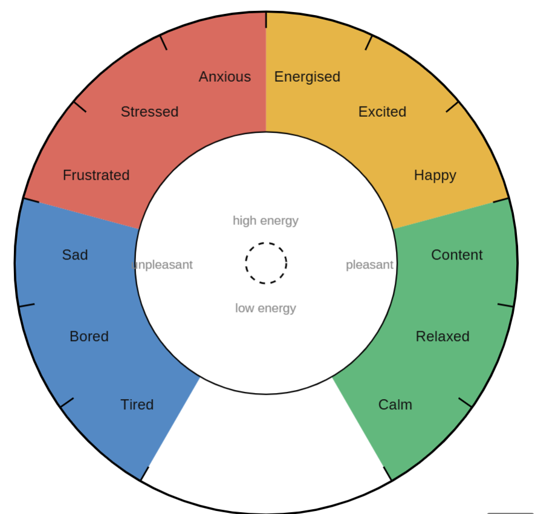
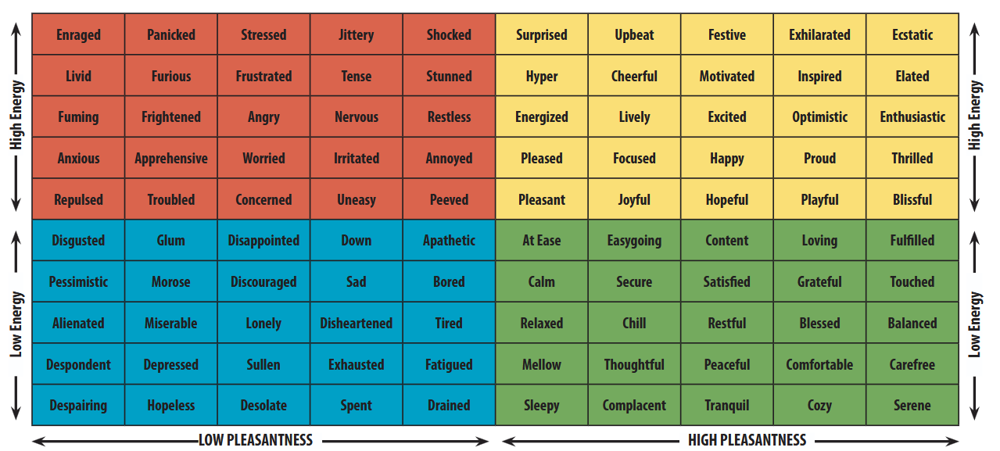
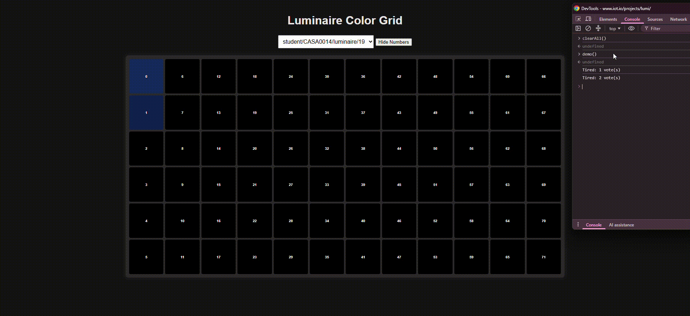

# Vespera as a Mood Meter
Mood shapes how we think and behave [1], which matters in a classroom, yet it's one of
the least visible things in it. This project turns Vespera [2] into a physical mood
meter inspired by the Yale Mood Meter [3], allowing students to check in with their
current emotional state.

| Pick a mood | Check in | Watch the dome (Vespera) |
|:-----------:|:--------:|:------------------------:|
|  |  |  |
| Turn the dial to one of 12 moods | Press the button; the OLED confirms | Your vote lights up on the dome |

# Contents
- [Overview](#overview)
  - [Concept](#concept)
  - [How it looks](#how-it-looks)
- [References](#references)

# Overview
## Concept
The Yale Mood Meter [3] splits emotion into four colour zones, following Russell's
circumplex model of affect [4]: emotion as a circle set by two axes (energy and
pleasantness).

From my understanding, Russell's model provides the theory, and the Yale Mood Meter
is its practical implementation, a colourful, user-friendly tool. So in this project,
I try to build a third bridge, bringing that framework into our physical classroom
through Vespera as a check-in system.

| Theory | Mapping |
|:------:|:-------:|
|  |  |
| Russell's circumplex: emotions on a 2D plane | 12 moods across 4 colour zones, on a 1D dial |
| *Source: [Wikimedia Commons](https://commons.wikimedia.org/wiki/File:Circumplex_model_of_emotion.svg), [LICENCE]* | *Printed dial face* |

The 12 moods sit around the dial in circumplex order, three per zone:

| Zone | Energy | Pleasantness | Moods |
|------|:------:|:------------:|-------|
| Blue | low | unpleasant | Tired, Bored, Sad |
| Red | high | unpleasant | Frustrated, Stressed, Anxious |
| Yellow | high | pleasant | Energised, Excited, Happy |
| Green | low | pleasant | Content, Relaxed, Calm |

The dial only covers the rim of Russell's circle, one axis instead of two, trading
nuance for a simple control.

## How it looks
The dome acts as a live mood chart. In the web viewer [6], each column is a mood (left
to right: Tired → Calm) and each row is a vote slot (top to bottom: 1st → 6th vote).
Each lit square is one student check-in, coloured by zone.

| Mood Meter [5] | Vespera Grid |
|:--------------:|:------------:|
|  |  |

# References
1. Naranowicz, M. (2022). Mood effects on semantic processes: Behavioural and
   electrophysiological evidence. *Frontiers in Psychology*, 13, 1014706.
   https://doi.org/10.3389/fpsyg.2022.1014706
2. Wilson, D. *Vespera*. CASA0014, UCL CASA.
   https://github.com/ucl-casa-ce/casa0014/tree/main/vespera
3. Yale Center for Emotional Intelligence. *Mood Meter*. RULER Approach.
   https://rulerapproach.org/wp-content/uploads/2020/07/MoodMeter_FC.pdf
4. Russell, J. A. (1980). A circumplex model of affect. *Journal of Personality and
   Social Psychology*, 39(6), 1161–1178.
   https://pdodds.w3.uvm.edu/research/papers/others/1980/russell1980a.pdf
5. University of New Hampshire. *Mood Meter* (2020).
   https://unhconnect.unh.edu/s/1518/images/gid4/editor_documents/moodmeter-2020.pdf
6. IoT.io. *Lumi* (Vespera web viewer). https://www.iot.io/projects/lumi/